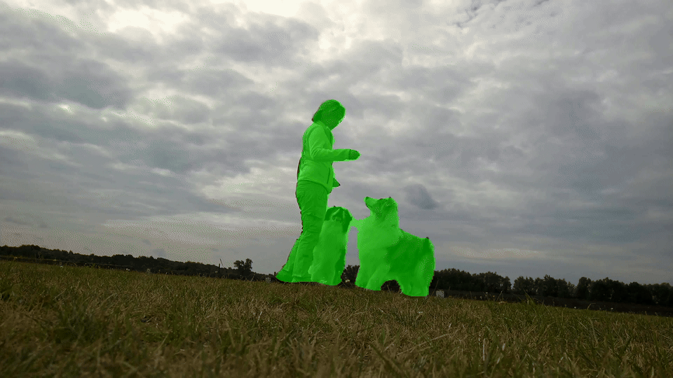
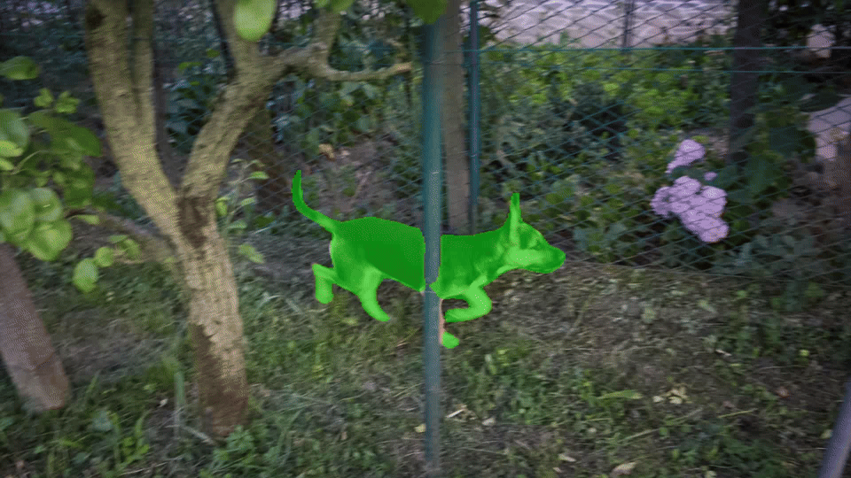
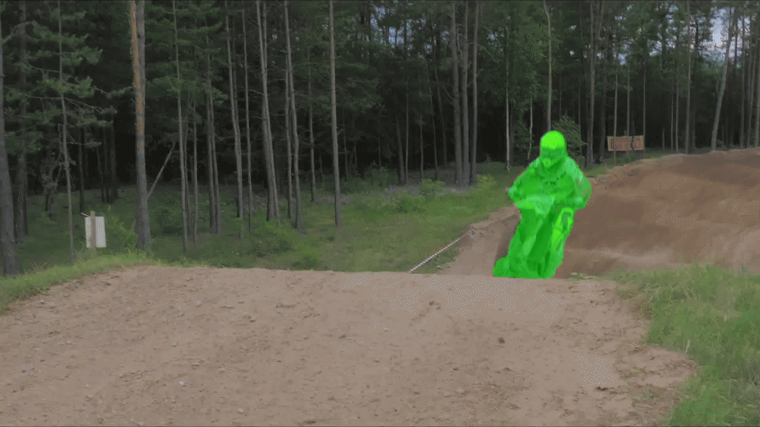
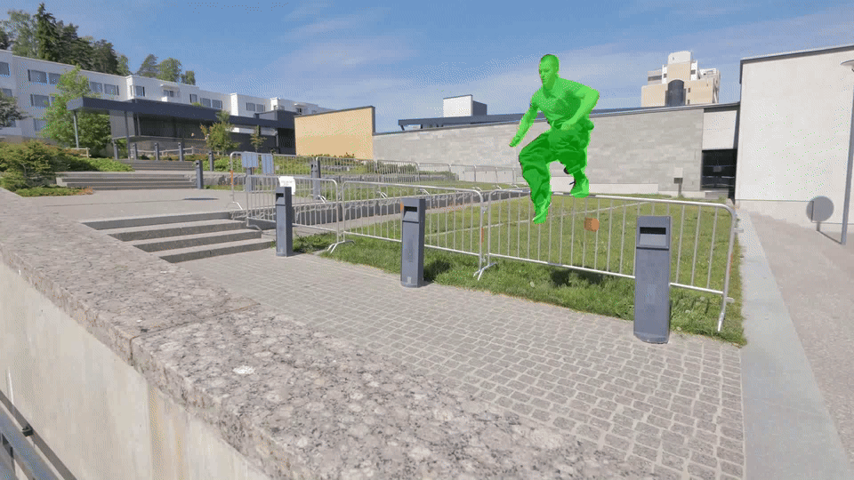
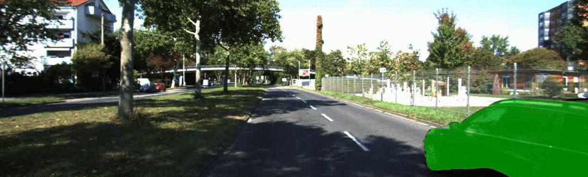
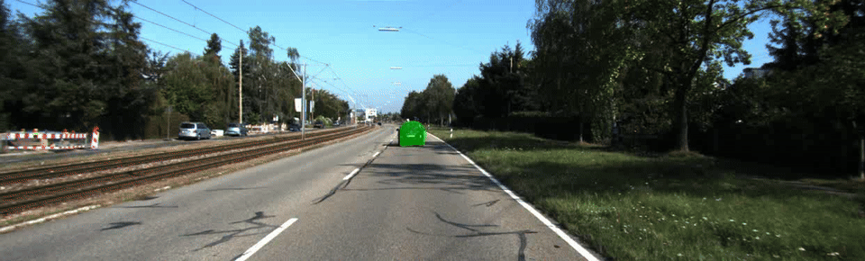
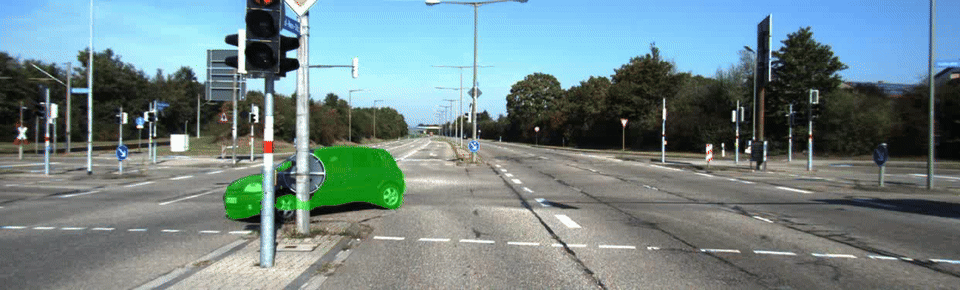
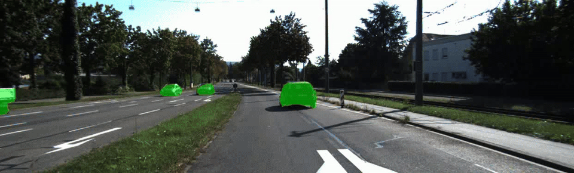
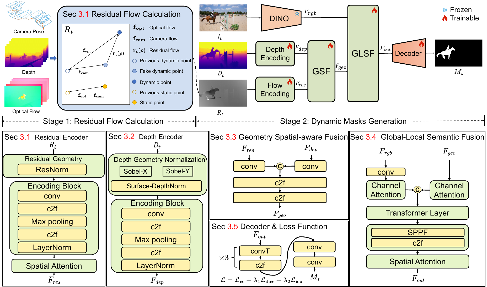

# DynOSeg: Dynamic Object Segmentation via Motion-Geometry Fusion

*Xu Han, Yiduo Wang, Yiran Wang, Viorela Ila*

Australian Centre for Robotics, School of Aerospace, Mechanical and Mechatronic Engineering, The University of Sydney

<!-- 

&nbsp;

  

 -->

## Visualization

<table align="center" width="100%">
  <tbody>
    <tr>
      <th colspan="4" align="center">DAVIS2017-M</th>
    </tr>
    <tr>
      <td align="center" width="25%">
        
      </td>
      <td align="center" width="25%">
        
      </td>
      <td align="center" width="25%">
        
      </td>
      <td align="center" width="25%">
        
      </td>
    </tr>
    <tr>
      <th colspan="4" align="center">KITTI</th>
    </tr>
    <tr>
      <td align="center" colspan="2" width="50%">
        
      </td>
      <td align="center" colspan="2" width="50%">
        
      </td>
    </tr>
    <tr>
      <td align="center" colspan="2" width="50%">
        
      </td>
      <td align="center" colspan="2" width="50%">
        
      </td>
    </tr>
  </tbody>
</table>

## Model Architecture

**Overview of the proposed DynOSeg framework.**
DynOSeg computes a residual map from depth, camera poses, and optical flow.
Dedicated encoders process the depth and residual maps, while a frozen DINOv2 encoder extracts high-level semantic features from the RGB image.
Geometry-Aware Spatial Fusion (GSF) and Global–Local Semantic-Aware Fusion (GLSF) integrate these multimodal features. A segmentation decoder then produces moving-object masks from the fused representation.

## Installation & Usage

The reference hardware and software environment is listed below:

<table align="center">
  <thead>
    <tr><th>Component</th><th>Specification</th></tr>
  </thead>
  <tbody>
    <tr><td>Operating system</td><td>Ubuntu 24.04.4 LTS (Noble Numbat)</td></tr>
    <tr><td>GPU</td><td>NVIDIA GeForce RTX 4090</td></tr>
    <tr><td>NVIDIA driver</td><td>580.159.03</td></tr>
    <tr><td>NVCC Compiler</td><td>V12.8.61</td></tr>
  </tbody>
</table>

**The code is comming soon!**

